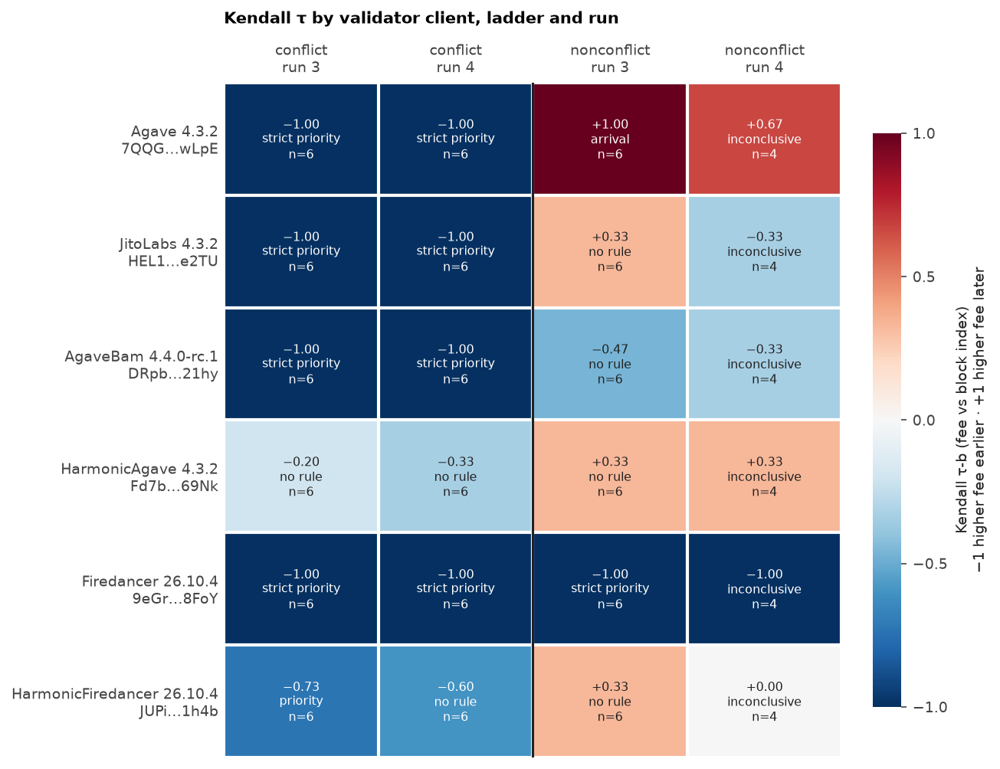
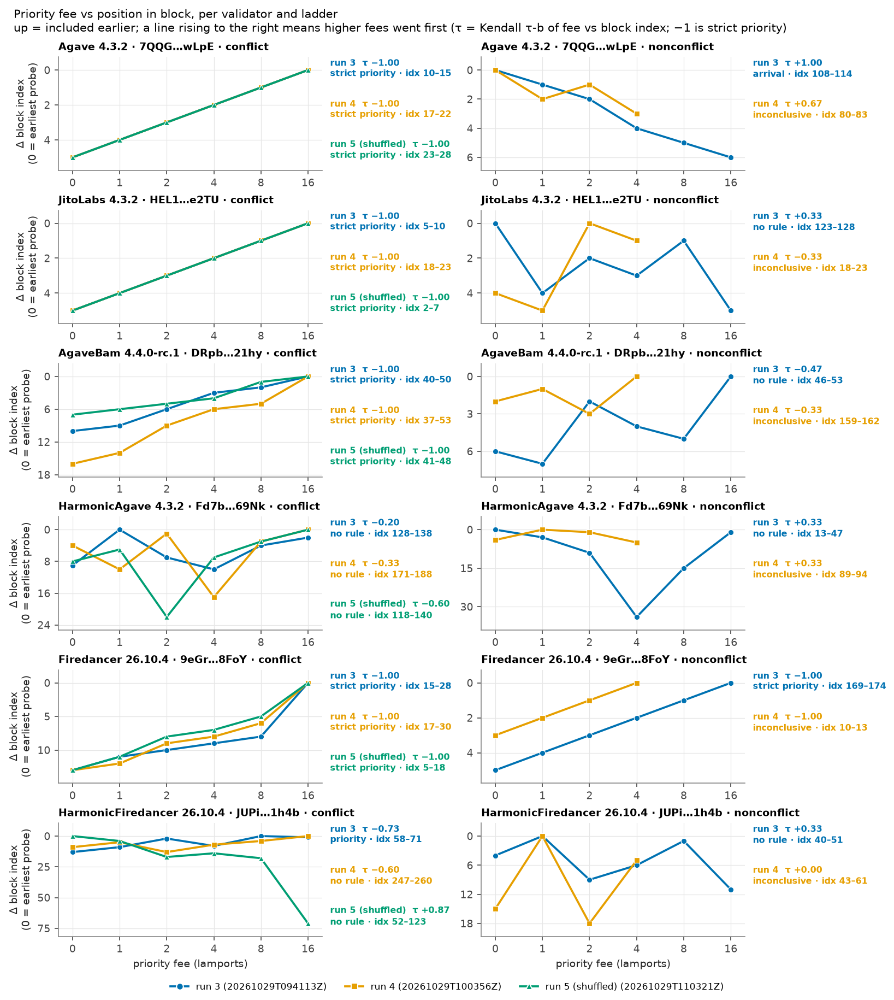
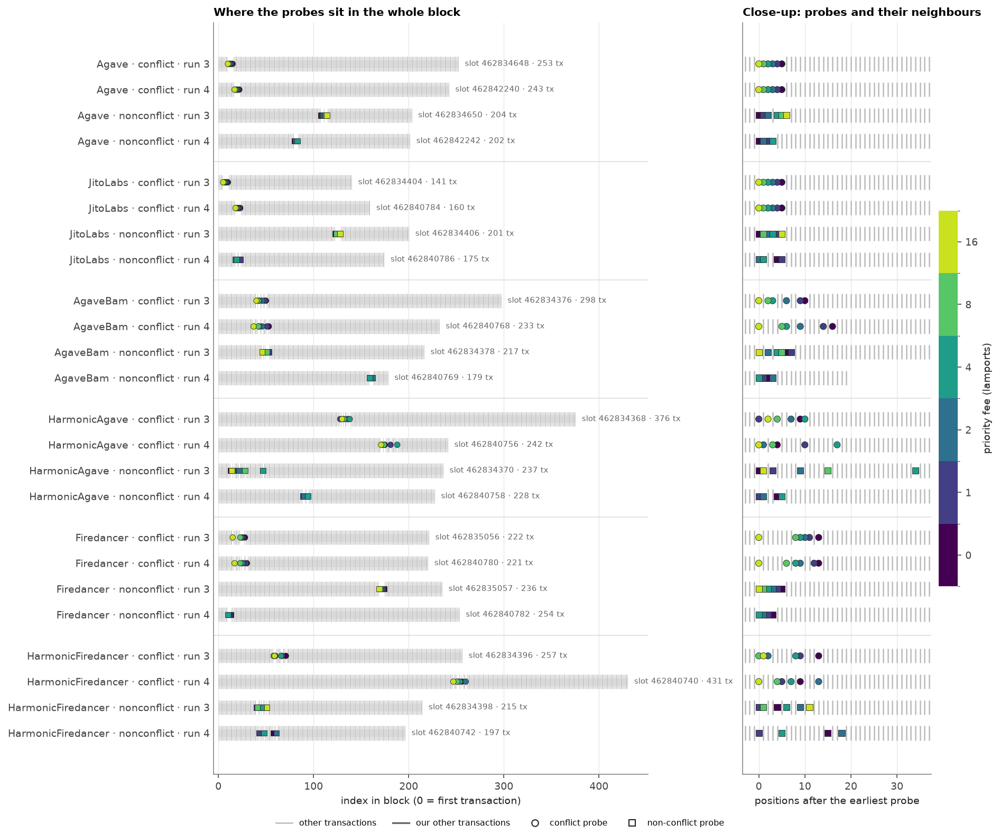
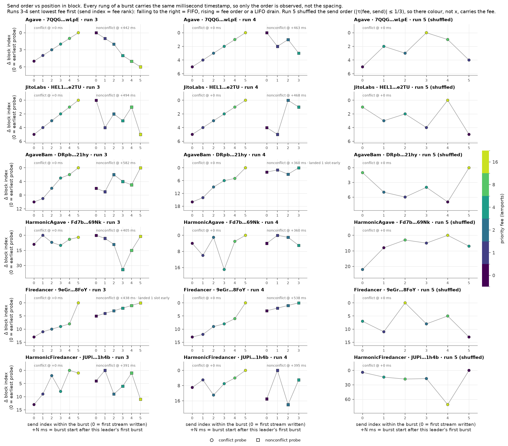
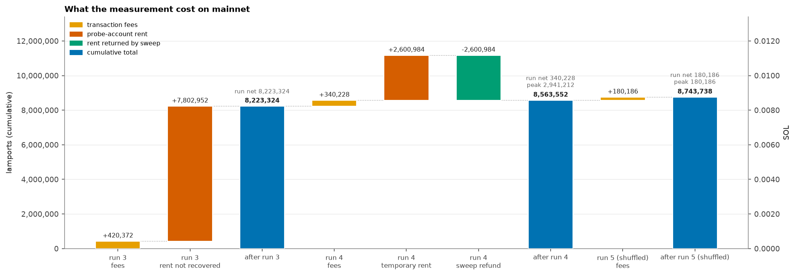

# Inside the Block: how Solana validators order transactions

Report for the Superteam Ukraine bounty [Inside the Block](https://earn.superteam.fun/listing/inside-the-block-how-solana-validators-order-transactions). Every number here is produced by `python -m analysis && python -m viz` from the committed raw data in [`data/runs/`](data/runs). Every claim links to the signatures and slots behind it: per-slot rows link to Solscan blocks, and [`analysis/output/EVIDENCE.md`](analysis/output/EVIDENCE.md) lists all 168 probe signatures with Solscan and Explorer links.

## Summary

- **Six mainnet leaders, six client labels, three live runs, 168/168 probes landed.** The leaders were Agave 4.3.2, JitoLabs 4.3.2, AgaveBam 4.4.0-rc.1, HarmonicAgave 4.3.2, Firedancer 26.10.4, and HarmonicFiredancer 26.10.4. All slots are 462,834,368 or later, well after the Alpenglow cutoff of 459,653,000. No Jito bundles or tips were sent.
- **Run 5 separates fee from send order on the conflict ladder.** It sent each six-rung conflict ladder in a seeded shuffle (`|tau(fee, send)| ≤ 1/3`). Agave, JitoLabs, AgaveBam, and Firedancer each landed in strict fee order (tau = −1, exact p = 1/720) while their send-order taus stayed between −0.20 and +0.33. A pure FIFO or LIFO drain of that shuffle cannot produce tau = −1. One slot per client.
- **Conflict ladder, all three runs:** 237 of 270 within-ladder pairs (0.878, 95% CI 0.756–0.967) put the higher fee earlier. The four clients above were perfect in every conflict slot, including the two ascending runs.
- **Non-conflict ladder (runs 3 and 4 only; run 5 did not send one):** 61 of 126 pairs (0.484, 95% CI 0.299–0.689). Firedancer was perfectly fee-ordered in its one qualifying slot. Agave reproduced send order. Run 4's four-rung ladders stay `inconclusive`.
- **HarmonicFiredancer's shuffled slot went the other way** (tau = +0.867, exact p = 0.0083). The pre-registered call is `no_rule_detected`. That is one slot, and it is reported as an anomaly below, not as a client rule.
- **Small n remains the main limit.** There is one slot per validator, per ladder, per run.

## Study header

| Field | Value |
| --- | --- |
| Report written (UTC date) | 2026-10-29 |
| Network | mainnet-beta |
| Measurement dates (UTC) | 2026-10-29 09:42:01–09:44:26 (run 3), 10:04:41–10:10:04 (run 4), 11:03:56–11:05:33 (run 5), from `blockTime` |
| Slots | 462,834,151–462,835,057 (run 3), 462,840,537–462,842,433 (run 4, sweep included), 462,857,372–462,857,824 (run 5); epoch 1071 |
| Alpenglow cutoff | slot ≥ 459,653,000; `getAgGenesisCert` returned slot 459,652,999 in all three manifests |
| Code measured | run 3 at `9d482c8`, run 4 at `164768b`, run 5 at `c8f4d89` (`manifest.json` → `git_sha`) |
| Run directories | [`data/runs/20261029T094113Z`](data/runs/20261029T094113Z) (run 3), [`data/runs/20261029T100356Z`](data/runs/20261029T100356Z) (run 4), [`data/runs/20261029T110321Z`](data/runs/20261029T110321Z) (run 5) |
| `MODE` | `live` (all three) |
| Spend cap | 0.05 SOL hard maximum in code. Run caps were 0.011 SOL (run 3) and 0.0035 SOL (run 4). Run 5's cumulative cap was 0.0012606 SOL, on a ledger that already held 760,600 lamports of fees |
| Funder (public key) | [`DK9sHVjV47u2trp7tVpAeCsgdaTcGyBh8WjZLUmCCRpM`](https://solscan.io/account/DK9sHVjV47u2trp7tVpAeCsgdaTcGyBh8WjZLUmCCRpM) |
| Client labels | `getClusterNodes` `clientId` (`classification_source: rpc`; no validators.app token) |
| Submit path | direct QUIC to the leader's `tpuQuic`; no RPC for probes; funding via RPC plus TPU fan-out |
| Burst timing | QUIC opened 12 slots ahead; burst written 1 slot before the target slot |
| Ladders | fees 0, 1, 2, 4, 8, 16 lamports at a 1,000 CU limit; run 4 non-conflict used 0, 1, 2, 4; run 5 sent the conflict ladder only |
| Send order | lowest fee first in runs 3 and 4 (`send_index` = fee rank). Run 5 shuffled (`design.send_order_seed` 3763027240) |
| TPU copies | 2 per probe in run 3 (code at `9d482c8`), 1 in runs 4 and 5 |
| RPC | `mainnet.helius-rpc.com` for the runs (key not retained); `api.mainnet-beta.solana.com` for the read-only raw-block backfill and the balance check |

## Design in one paragraph

Each leader gets two ladders in one four-slot window: a **conflict** ladder in the window's first slot and a **non-conflict** ladder two slots later. Run 5 skipped the non-conflict ladder. A ladder is six legacy transactions that differ only in priority fee. Each one is `SetComputeUnitLimit(1000)`, `SetComputeUnitPrice`, and a 1-lamport system transfer, and they carry no memo. The conflict ladder in runs 4 and 5 is six **1-lamport self-transfers from the funder**, so every rung write-locks only the funder. In run 3 (older code) it was funder → one shared recipient, so every rung write-locked the funder and that recipient. The non-conflict ladder uses a **distinct ephemeral payer per rung** (a self-transfer in run 4; payer → its own recipient in run 3), so no two rungs share a writable account. The raw blocks confirm both lock patterns for every ladder (`ladder_writable_accounts` in [`ladder_statistics.csv`](analysis/output/ladder_statistics.csv)). The burst goes out over an already-open QUIC connection to the target leader's TPU, one slot before its window. The statistic is Kendall tau-b between priority fee and zero-based block index, using our landed signatures only. Run 5 also records tau-b between send index and block index, because those two orders were no longer the same.

## Fee order and send order

Runs 3 and 4 cannot separate a fee sort from a last-in-first-out drain. Run 5 can, on the conflict ladder, for the four clients that landed in strict fee order.

**Runs 3 and 4.** In all 24 ladders `send_index` rises one-for-one with the priority fee: tau-b(fee, send index) = +1 (column `tau_fee_send`). All rungs of a burst share one `send_unix_ms`. Arrival at the leader is unobserved: each probe is its own QUIC stream, and the leader may read those streams in a different order than they were written. On that design a fee sort and a LIFO drain predict the same block order (tau = −1), and FIFO predicts the opposite (tau = +1). The two can be told apart only by the sign of tau.

**Run 5.** `send_order: shuffled`, seed 3763027240, conflict ladder only, one copy. The planner keeps only permutations with |tau-b(fee, send)| ≤ 1/3. The six permutations, as (send index, fee), were:

| Client | Send order (fee at send index 0…5) | tau(fee, send) |
| --- | --- | ---: |
| JitoLabs | 8, 2, 4, 1, 16, 0 | −0.333 |
| HarmonicAgave | 2, 0, 8, 1, 16, 4 | +0.333 |
| Agave | 0, 4, 2, 16, 8, 1 | +0.200 |
| Firedancer | 4, 1, 16, 2, 8, 0 | −0.200 |
| AgaveBam | 8, 2, 1, 4, 0, 16 | −0.067 |
| HarmonicFiredancer | 1, 4, 8, 2, 16, 0 | +0.067 |

On a shuffle like that:

| Mechanism | Predicts |
| --- | --- |
| Fee priority | tau(fee, block) = −1 |
| FIFO arrival | tau(send, block) = +1, so \|tau(fee, block)\| ≤ 1/3 |
| LIFO drain | tau(send, block) = −1, so \|tau(fee, block)\| ≤ 1/3 |

A tau(fee, block) of −1 is then incompatible with either pure arrival rule. For six distinct rungs that ranking is 1 of 720 permutations (exact p = 0.001389).

Agave, Firedancer, AgaveBam, and JitoLabs each hit tau(fee, block) = −1. Their tau(send, block) values were −0.200, +0.200, +0.067, and +0.333. **For these four clients, on this conflict ladder, strict priority is confirmed independently of send order.** It is one slot each. It does not extend to the non-conflict ladder, which run 5 did not send and which in runs 3 and 4 is still collinear with send order.

HarmonicAgave's shuffled slot was tau(fee) = −0.600 (p = 0.068, tau(send) = −0.467), which stays `no_rule_detected`. HarmonicFiredancer is the anomaly in the next section.

`--send-order descending` has not been run. It would make fee order and FIFO agree, and would test a LIFO drain directly.

## Analysis and decision rule

Tau-b is Kendall tau-b between priority fee and zero-based block index (votes included in the index; run 5's six blocks contain none). A value of −1 is perfect high-fee-first order. A value of +1 is perfect low-fee-first order. The p-value is the exact one-sided probability in the observed direction, from enumerating all `n!` block orders. The pre-registered calls ([methodology §9.3](docs/METHODOLOGY.md#93-send-order)) require n ≥ 5. `strict_priority` needs tau = −1. `priority` needs tau ≤ −0.6, p ≤ 0.05, and fee-pair share > 0.5. `arrival` is the same thresholds on send index (`tau_send_b`), which matches the old fee-based mirror image when the ladder was sent lowest-fee-first. Everything else is `no_rule_detected`. The thresholds were not changed after seeing the data.

Pooled shares count every within-ladder pair. The 95% percentile intervals resample complete validator-run ladders (10,000 replicates, seed `20261029`), not dependent pairs. One `random.Random` is shared across the scopes, in the order all, conflict, non-conflict, so adding run 5 moves the non-conflict interval even though those 12 ladders did not change. Source: [`pooled_pair_shares.csv`](analysis/output/pooled_pair_shares.csv).

| Scope | Ladder observations | Pairs | Fee-order share (95% CI) | Arrival-order share (95% CI) |
| --- | ---: | ---: | ---: | ---: |
| All | 30 | 396 | 298/396 = 0.753 (0.630–0.864) | 127/396 = 0.321 (0.213–0.433) |
| Conflict | 18 | 270 | 237/270 = 0.878 (0.756–0.967) | 62/270 = 0.230 (0.119–0.344) |
| Non-conflict | 12 | 126 | 61/126 = 0.484 (0.299–0.689) | 65/126 = 0.516 (0.311–0.701) |

Fee-order and arrival-order shares sum to 1 on the non-conflict rows, because those ladders were sent lowest-fee-first and the two orders are reverses. They do not sum to 1 on the all or conflict rows: run 5's shuffles are not reverses, so a pair can agree with both orders or with neither. The non-conflict point estimate is the same 61/126 as before run 5. Its interval moved from 0.306–0.684 to 0.299–0.689 only because of the shared random stream. These pooled values are descriptive. Validators, clients, ladder lengths, and blocks are not exchangeable random samples of mainnet.

## Per-validator results

Rollups follow methodology §9.3. The headline rollup drops `inconclusive` and contaminated slots. No slot was contaminated, so the inclusive rollup is identical. Source: [`validator_rollups.csv`](analysis/output/validator_rollups.csv). Conflict taus are run 3, run 4, run 5. Non-conflict taus are run 3, run 4; run 5 sent none.

| Identity | Client / version | Stake (SOL) | Conflict call (slots) | Conflict tau-b by run | Non-conflict call (qualifying slots) | Non-conflict tau-b by run | Confidence |
| --- | --- | ---: | --- | --- | --- | --- | --- |
| [`7QQG…wLpE`](https://solscan.io/account/7QQGNm3ptwinipDCyaCF7jY5katgmFUu1ieP2f7nwLpE) | Agave 4.3.2 | 1,875,001.953 | `strict_priority` (3) | [−1.000](analysis/output/EVIDENCE.md#20261029t094113z-agave-conflict), [−1.000](analysis/output/EVIDENCE.md#20261029t100356z-agave-conflict), [−1.000](analysis/output/EVIDENCE.md#20261029t110321z-agave-conflict) | `arrival` (1; run 4 inconclusive) | [+1.000](analysis/output/EVIDENCE.md#20261029t094113z-agave-nonconflict), [+0.667](analysis/output/EVIDENCE.md#20261029t100356z-agave-nonconflict) | limited |
| [`HEL1…e2TU`](https://solscan.io/account/HEL1USMZKAL2odpNBj2oCjffnFGaYwmbGmyewGv1e2TU) | JitoLabs 4.3.2 | 16,665,444.377 | `strict_priority` (3) | [−1.000](analysis/output/EVIDENCE.md#20261029t094113z-jitolabs-conflict), [−1.000](analysis/output/EVIDENCE.md#20261029t100356z-jitolabs-conflict), [−1.000](analysis/output/EVIDENCE.md#20261029t110321z-jitolabs-conflict) | `no_rule_detected` (1) | [+0.333](analysis/output/EVIDENCE.md#20261029t094113z-jitolabs-nonconflict), [−0.333](analysis/output/EVIDENCE.md#20261029t100356z-jitolabs-nonconflict) | limited |
| [`DRpb…21hy`](https://solscan.io/account/DRpbCBMxVnDK7maPM5tGv6MvB3v1sRMC86PZ8okm21hy) | AgaveBam 4.4.0-rc.1 | 12,878,826.063 | `strict_priority` (3) | [−1.000](analysis/output/EVIDENCE.md#20261029t094113z-agavebam-conflict), [−1.000](analysis/output/EVIDENCE.md#20261029t100356z-agavebam-conflict), [−1.000](analysis/output/EVIDENCE.md#20261029t110321z-agavebam-conflict) | `no_rule_detected` (1) | [−0.467](analysis/output/EVIDENCE.md#20261029t094113z-agavebam-nonconflict), [−0.333](analysis/output/EVIDENCE.md#20261029t100356z-agavebam-nonconflict) | limited |
| [`Fd7b…69Nk`](https://solscan.io/account/Fd7btgySsrjuo25CJCj7oE7VPMyezDhnx7pZkj2v69Nk) | HarmonicAgave 4.3.2 | 17,028,574.245 | `no_rule_detected` (3) | [−0.200](analysis/output/EVIDENCE.md#20261029t094113z-harmonicagave-conflict), [−0.333](analysis/output/EVIDENCE.md#20261029t100356z-harmonicagave-conflict), [−0.600](analysis/output/EVIDENCE.md#20261029t110321z-harmonicagave-conflict) | `no_rule_detected` (1) | [+0.333](analysis/output/EVIDENCE.md#20261029t094113z-harmonicagave-nonconflict), [+0.333](analysis/output/EVIDENCE.md#20261029t100356z-harmonicagave-nonconflict) | limited |
| [`9eGr…8FoY`](https://solscan.io/account/9eGrDohdNTAo61DRHyfMuqKWXqYnA3i254Wiszxe8FoY) | Firedancer 26.10.4 | 6,646,427.910 | `strict_priority` (3) | [−1.000](analysis/output/EVIDENCE.md#20261029t094113z-firedancer-conflict), [−1.000](analysis/output/EVIDENCE.md#20261029t100356z-firedancer-conflict), [−1.000](analysis/output/EVIDENCE.md#20261029t110321z-firedancer-conflict) | `strict_priority` (1; run 4 inconclusive) | [−1.000](analysis/output/EVIDENCE.md#20261029t094113z-firedancer-nonconflict), [−1.000](analysis/output/EVIDENCE.md#20261029t100356z-firedancer-nonconflict) | limited |
| [`JUPi…1h4b`](https://solscan.io/account/JUPiTERrZqgf1jUyR7dSkhMx4Kn2qJyekWsg3LT1h4b) | HarmonicFiredancer 26.10.4 | 9,705,355.838 | `mixed_across_slots` (3) | [−0.733](analysis/output/EVIDENCE.md#20261029t094113z-harmonicfiredancer-conflict), [−0.600](analysis/output/EVIDENCE.md#20261029t100356z-harmonicfiredancer-conflict), [+0.867](analysis/output/EVIDENCE.md#20261029t110321z-harmonicfiredancer-conflict) | `no_rule_detected` (1) | [+0.333](analysis/output/EVIDENCE.md#20261029t094113z-harmonicfiredancer-nonconflict), [0.000](analysis/output/EVIDENCE.md#20261029t100356z-harmonicfiredancer-nonconflict) | limited |

Confidence is `limited` everywhere: at most three conflict slots, one qualifying non-conflict slot, and the non-conflict ladders still have collinear fee and send order. Stake is `activatedStake` from `getVoteAccounts` at run 5 selection, rounded to three decimals. Only the Agave identity was outside the ten largest by stake.



*Figure 2.* Kendall tau-b of fee against block index for every validator, ladder, and run, with the pre-registered call and n. Blue means higher fee earlier. In runs 3 and 4 that is also reverse send order. Run 5 shuffled the two orders apart; its conflict column is the test of that.

### Per-slot detail

Every row is one ladder in one block. The slot links to Solscan, and "rungs" links to the signatures in [`EVIDENCE.md`](analysis/output/EVIDENCE.md). `tau(send)` is tau-b between send index and block index. `tau(fee, send)` is tau-b between fee and send index: +1 when the ladder was sent lowest-fee-first, and inside ±1/3 for every run-5 ladder. The checks on the stored raw block are:

- the `Fee` reward recipient equals the target identity in all 30 blocks;
- every block index re-derives from the raw transaction list;
- the transaction count matches `block_context.jsonl`;
- **foreign writers** counts other transactions in that block that write any account our ladder locks (methodology "contamination"). It is 0 everywhere.

"Landed vs target" is the landed slot minus the planned slot. Two non-conflict ladders landed one slot early, still inside the same leader's window. All six run-5 ladders landed on the target slot.

| Run | Client | Slot (Solscan) | Ladder | n | tau-b | Fee-pair share | Arrival-pair share | Exact p | tau(send) | tau(fee, send) | Landed vs target | Foreign writers | Call | Evidence |
| --- | --- | ---: | --- | ---: | ---: | ---: | ---: | ---: | ---: | ---: | ---: | ---: | --- | --- |
| 3 | Agave | [462834648](https://solscan.io/block/462834648) | conflict | 6 | −1.000 | 1.000 | 0.000 | 0.001389 | −1.000 | +1.000 | 0 | 0 | `strict_priority` | [rungs](analysis/output/EVIDENCE.md#20261029t094113z-agave-conflict) |
| 3 | Agave | [462834650](https://solscan.io/block/462834650) | non-conflict | 6 | +1.000 | 0.000 | 1.000 | 0.001389 | +1.000 | +1.000 | 0 | 0 | `arrival` | [rungs](analysis/output/EVIDENCE.md#20261029t094113z-agave-nonconflict) |
| 3 | JitoLabs | [462834404](https://solscan.io/block/462834404) | conflict | 6 | −1.000 | 1.000 | 0.000 | 0.001389 | −1.000 | +1.000 | 0 | 0 | `strict_priority` | [rungs](analysis/output/EVIDENCE.md#20261029t094113z-jitolabs-conflict) |
| 3 | JitoLabs | [462834406](https://solscan.io/block/462834406) | non-conflict | 6 | +0.333 | 0.333 | 0.667 | 0.234722 | +0.333 | +1.000 | 0 | 0 | `no_rule_detected` | [rungs](analysis/output/EVIDENCE.md#20261029t094113z-jitolabs-nonconflict) |
| 3 | AgaveBam | [462834376](https://solscan.io/block/462834376) | conflict | 6 | −1.000 | 1.000 | 0.000 | 0.001389 | −1.000 | +1.000 | 0 | 0 | `strict_priority` | [rungs](analysis/output/EVIDENCE.md#20261029t094113z-agavebam-conflict) |
| 3 | AgaveBam | [462834378](https://solscan.io/block/462834378) | non-conflict | 6 | −0.467 | 0.733 | 0.267 | 0.136111 | −0.467 | +1.000 | 0 | 0 | `no_rule_detected` | [rungs](analysis/output/EVIDENCE.md#20261029t094113z-agavebam-nonconflict) |
| 3 | HarmonicAgave | [462834368](https://solscan.io/block/462834368) | conflict | 6 | −0.200 | 0.600 | 0.400 | 0.359722 | −0.200 | +1.000 | 0 | 0 | `no_rule_detected` | [rungs](analysis/output/EVIDENCE.md#20261029t094113z-harmonicagave-conflict) |
| 3 | HarmonicAgave | [462834370](https://solscan.io/block/462834370) | non-conflict | 6 | +0.333 | 0.333 | 0.667 | 0.234722 | +0.333 | +1.000 | 0 | 0 | `no_rule_detected` | [rungs](analysis/output/EVIDENCE.md#20261029t094113z-harmonicagave-nonconflict) |
| 3 | Firedancer | [462835056](https://solscan.io/block/462835056) | conflict | 6 | −1.000 | 1.000 | 0.000 | 0.001389 | −1.000 | +1.000 | 0 | 0 | `strict_priority` | [rungs](analysis/output/EVIDENCE.md#20261029t094113z-firedancer-conflict) |
| 3 | Firedancer | [462835057](https://solscan.io/block/462835057) | non-conflict | 6 | −1.000 | 1.000 | 0.000 | 0.001389 | −1.000 | +1.000 | −1 | 0 | `strict_priority` | [rungs](analysis/output/EVIDENCE.md#20261029t094113z-firedancer-nonconflict) |
| 3 | HarmonicFiredancer | [462834396](https://solscan.io/block/462834396) | conflict | 6 | −0.733 | 0.867 | 0.133 | 0.027778 | −0.733 | +1.000 | 0 | 0 | `priority` | [rungs](analysis/output/EVIDENCE.md#20261029t094113z-harmonicfiredancer-conflict) |
| 3 | HarmonicFiredancer | [462834398](https://solscan.io/block/462834398) | non-conflict | 6 | +0.333 | 0.333 | 0.667 | 0.234722 | +0.333 | +1.000 | 0 | 0 | `no_rule_detected` | [rungs](analysis/output/EVIDENCE.md#20261029t094113z-harmonicfiredancer-nonconflict) |
| 4 | Agave | [462842240](https://solscan.io/block/462842240) | conflict | 6 | −1.000 | 1.000 | 0.000 | 0.001389 | −1.000 | +1.000 | 0 | 0 | `strict_priority` | [rungs](analysis/output/EVIDENCE.md#20261029t100356z-agave-conflict) |
| 4 | Agave | [462842242](https://solscan.io/block/462842242) | non-conflict | 4 | +0.667 | 0.167 | 0.833 | 0.166667 | +0.667 | +1.000 | 0 | 0 | `inconclusive` | [rungs](analysis/output/EVIDENCE.md#20261029t100356z-agave-nonconflict) |
| 4 | JitoLabs | [462840784](https://solscan.io/block/462840784) | conflict | 6 | −1.000 | 1.000 | 0.000 | 0.001389 | −1.000 | +1.000 | 0 | 0 | `strict_priority` | [rungs](analysis/output/EVIDENCE.md#20261029t100356z-jitolabs-conflict) |
| 4 | JitoLabs | [462840786](https://solscan.io/block/462840786) | non-conflict | 4 | −0.333 | 0.667 | 0.333 | 0.375000 | −0.333 | +1.000 | 0 | 0 | `inconclusive` | [rungs](analysis/output/EVIDENCE.md#20261029t100356z-jitolabs-nonconflict) |
| 4 | AgaveBam | [462840768](https://solscan.io/block/462840768) | conflict | 6 | −1.000 | 1.000 | 0.000 | 0.001389 | −1.000 | +1.000 | 0 | 0 | `strict_priority` | [rungs](analysis/output/EVIDENCE.md#20261029t100356z-agavebam-conflict) |
| 4 | AgaveBam | [462840769](https://solscan.io/block/462840769) | non-conflict | 4 | −0.333 | 0.667 | 0.333 | 0.375000 | −0.333 | +1.000 | −1 | 0 | `inconclusive` | [rungs](analysis/output/EVIDENCE.md#20261029t100356z-agavebam-nonconflict) |
| 4 | HarmonicAgave | [462840756](https://solscan.io/block/462840756) | conflict | 6 | −0.333 | 0.667 | 0.333 | 0.234722 | −0.333 | +1.000 | 0 | 0 | `no_rule_detected` | [rungs](analysis/output/EVIDENCE.md#20261029t100356z-harmonicagave-conflict) |
| 4 | HarmonicAgave | [462840758](https://solscan.io/block/462840758) | non-conflict | 4 | +0.333 | 0.333 | 0.667 | 0.375000 | +0.333 | +1.000 | 0 | 0 | `inconclusive` | [rungs](analysis/output/EVIDENCE.md#20261029t100356z-harmonicagave-nonconflict) |
| 4 | Firedancer | [462840780](https://solscan.io/block/462840780) | conflict | 6 | −1.000 | 1.000 | 0.000 | 0.001389 | −1.000 | +1.000 | 0 | 0 | `strict_priority` | [rungs](analysis/output/EVIDENCE.md#20261029t100356z-firedancer-conflict) |
| 4 | Firedancer | [462840782](https://solscan.io/block/462840782) | non-conflict | 4 | −1.000 | 1.000 | 0.000 | 0.041667 | −1.000 | +1.000 | 0 | 0 | `inconclusive` | [rungs](analysis/output/EVIDENCE.md#20261029t100356z-firedancer-nonconflict) |
| 4 | HarmonicFiredancer | [462840740](https://solscan.io/block/462840740) | conflict | 6 | −0.600 | 0.800 | 0.200 | 0.068056 | −0.600 | +1.000 | 0 | 0 | `no_rule_detected` | [rungs](analysis/output/EVIDENCE.md#20261029t100356z-harmonicfiredancer-conflict) |
| 4 | HarmonicFiredancer | [462840742](https://solscan.io/block/462840742) | non-conflict | 4 | 0.000 | 0.500 | 0.500 | 0.250000 | 0.000 | +1.000 | 0 | 0 | `inconclusive` | [rungs](analysis/output/EVIDENCE.md#20261029t100356z-harmonicfiredancer-nonconflict) |
| 5 | Agave | [462857452](https://solscan.io/block/462857452) | conflict | 6 | −1.000 | 1.000 | 0.400 | 0.001389 | −0.200 | +0.200 | 0 | 0 | `strict_priority` | [rungs](analysis/output/EVIDENCE.md#20261029t110321z-agave-conflict) |
| 5 | JitoLabs | [462857372](https://solscan.io/block/462857372) | conflict | 6 | −1.000 | 1.000 | 0.667 | 0.001389 | +0.333 | −0.333 | 0 | 0 | `strict_priority` | [rungs](analysis/output/EVIDENCE.md#20261029t110321z-jitolabs-conflict) |
| 5 | AgaveBam | [462857608](https://solscan.io/block/462857608) | conflict | 6 | −1.000 | 1.000 | 0.533 | 0.001389 | +0.067 | −0.067 | 0 | 0 | `strict_priority` | [rungs](analysis/output/EVIDENCE.md#20261029t110321z-agavebam-conflict) |
| 5 | HarmonicAgave | [462857432](https://solscan.io/block/462857432) | conflict | 6 | −0.600 | 0.800 | 0.267 | 0.068056 | −0.467 | +0.333 | 0 | 0 | `no_rule_detected` | [rungs](analysis/output/EVIDENCE.md#20261029t110321z-harmonicagave-conflict) |
| 5 | Firedancer | [462857544](https://solscan.io/block/462857544) | conflict | 6 | −1.000 | 1.000 | 0.600 | 0.001389 | +0.200 | −0.200 | 0 | 0 | `strict_priority` | [rungs](analysis/output/EVIDENCE.md#20261029t110321z-firedancer-conflict) |
| 5 | HarmonicFiredancer | [462857824](https://solscan.io/block/462857824) | conflict | 6 | +0.867 | 0.067 | 0.600 | 0.008333 | +0.200 | +0.067 | 0 | 0 | `no_rule_detected` | [rungs](analysis/output/EVIDENCE.md#20261029t110321z-harmonicfiredancer-conflict) |

Machine-readable source: [`ladder_statistics.csv`](analysis/output/ladder_statistics.csv). Every rung's signature, slot, fee, send index, block index, and explorer URL is in [`evidence_transactions.csv`](analysis/output/evidence_transactions.csv).

### HarmonicFiredancer in run 5

Slot [462857824](https://solscan.io/block/462857824) is one shuffled conflict ladder, n = 6, and the pre-registered call is `no_rule_detected`. The fee ranking itself is the reverse of a fee sort: tau-b = +0.867 (13/15), fee-pair share 1/15, exact one-sided p = 0.008333. tau(send) = +0.200, so the block is not FIFO and not LIFO either. The rollup across the three conflict slots (`priority`, `no_rule_detected`, `no_rule_detected`) stays `mixed_across_slots`.

The six rungs, in block order ([rungs](analysis/output/EVIDENCE.md#20261029t110321z-harmonicfiredancer-conflict)):

| Block index | Priority fee | Send index | `meta.fee` |
| ---: | ---: | ---: | ---: |
| 52 | 0 | 5 | 5,000 |
| 56 | 1 | 0 | 5,001 |
| 66 | 4 | 1 | 5,004 |
| 69 | 2 | 3 | 5,002 |
| 70 | 8 | 2 | 5,008 |
| 123 | 16 | 4 | 5,016 |

The block has 489 transactions and no vote transactions. The first five rungs sit in a span of 18 indexes (foreign-transaction gaps 3, 9, 2, 0). The fee-16 rung is 52 transactions later. The whole ladder spans 71 indexes. The same identity's conflict ladders in runs 3 and 4 each spanned 13. Dropping the fee-16 rung leaves tau = +0.80 on the other five (9 of 10 pairs have the lower fee earlier), so the reversal is not only the late rung.

Transactions between index 71 and 123 have `meta.fee` from 5,000 to 10,035 (median 5,000), and 23 of those 52 are errors. The block is not a global sort by fee. Our ladder's internal order is the observation.

These are hypotheses for one slot. None of them is identified.

1. **The burst was split across scheduling batches.** Five rungs landed together and the highest fee landed much later, after a gap that is not itself a run of higher fees. A microblock or batch boundary would do that. The same split does not explain the +0.80 among the first five.
2. **A shared ingress reordered the burst.** HarmonicAgave's `tpuQuic` was `198.13.140.105:12341` and HarmonicFiredancer's was `198.13.140.105:12349`. Their gossip addresses differ (`141.95.45.24` and `88.216.36.133`). A shared front end could batch or reorder before the validator's own scheduler. HarmonicAgave, on the same address and in the same run, had tau(fee) = −0.600, so the shared address does not by itself produce a reversal.
3. **A separate scheduler or bundle lane took part of the burst.** We sent no bundle and no tip, and the block does not label a lane. A path that admits some of our transactions on a different schedule than the native pack is consistent with the gap and is not shown.
4. **Chance.** Six of 720 permutations are at least this far reversed (one-sided p = 0.008333). The symmetric two-sided count is 12/720. Across 30 ladders, that extreme is expected about 0.5 times if every ranking were an independent random permutation. The pre-registered alternatives on this slot were priority (tau ≤ −0.6) and arrival on send index (tau(send) = +0.20, which fails). "Inverse fee order" was not a pre-registered call.

One slot does not make a HarmonicFiredancer rule, and it does not undo the strict fee order on the four other clients in the same run.

## Figures

All five are regenerated by `python -m viz` from `data/runs/` ([`figures/README.md`](figures/README.md)). SVG versions sit next to each PNG.



*Figure 1.* Priority fee against relative block index for each validator and ladder, one line per run. A line rising to the right means higher fees went first. In runs 3 and 4 a reverse-arrival drain would draw the same line. Run 5 shuffled send order, so a rising line in that run is fee order.



*Figure 3.* Where the probes sit in the whole block (left) and among their neighbours (right). Run 5's HarmonicFiredancer ladder is the long span.



*Figure 4.* Send index against relative block index for each burst. The x axis is order only, because all rungs in a burst share one millisecond timestamp. In runs 3 and 4 send index equals fee rank, so those panels are fig. 1 mirrored. Run 5 shuffled the send order, so colour, not x, carries the fee, and those panels are a separate view.



*Figure 5.* Cumulative mainnet cost: fees, run 3's stranded rent, run 4's temporary rent that the sweep returned, and run 5's fees.

## Cross-run consistency

On the six-rung conflict ladder, five of six identities made the same pre-registered call in all three runs. Agave, Firedancer, JitoLabs, and AgaveBam were perfectly fee-ordered in both ascending runs and in the shuffled run. HarmonicAgave repeated `no_rule_detected` (taus −0.200, −0.333, −0.600). HarmonicFiredancer moved from `priority` (p = 0.0278) to `no_rule_detected` (p = 0.0681) to the reversed shuffled slot (p = 0.0083, still `no_rule_detected`). Its rollup is `mixed_across_slots`.

The three runs are not exact replicates. Run 3 locked two accounts on the conflict ladder and wrote each burst twice. Runs 4 and 5 locked one account and wrote each burst once. Runs 3 and 4 sent lowest-fee-first; run 5 shuffled. The four clients that were strict in every conflict slot were strict under both lock patterns, both copy counts, and both send orders.

Run 4 cannot confirm any non-conflict call because all six of its ladders have four rungs. Descriptively, Firedancer repeated perfect fee order and Agave again leaned toward send order. Those are consistency checks, not second qualifying samples. Source: [`cross_run_consistency.csv`](analysis/output/cross_run_consistency.csv).

## Position within the block

The first rung of a ladder sat between 0.84% and 89.3% of the way through its block, and the latest final rung was at 91.0%. The median first position was 14.7% overall, 11.2% for conflict ladders, and 30.6% for non-conflict ladders. The median block held 234.5 transactions.

Adjacent rungs usually stayed together. Between adjacent rungs the median number of foreign transactions was 0, the mean 1.56, and the maximum 52 (run 5, HarmonicFiredancer conflict, the gap before the fee-16 rung). Conflict ladders had mean 1.76 and maximum 52; non-conflict ladders had mean 1.19 and maximum 18. Excluding that one run-5 gap, the maximum is 18. These are covariates, not assigned treatments. Conflict ladders always went to the window's first slot and non-conflict ladders two slots later, so slot-in-window is confounded with ladder type. Source: [`block_positions.csv`](analysis/output/block_positions.csv).

## Measurement log

All times are UTC on 2026-10-29. Rows come from `live-stderr.log` and `blockTime` in each run directory.

| UTC time | Action | Result |
| --- | --- | --- |
| before 09:17 | Run 1 (`20261029T085637Z`, not committed) | 12 of 13 groups skipped on slow slot polling; one Jito TPU closed with `0x174 peer sent no certificates`; 0 landed |
| 09:17–09:22 | Run 2 (`20261029T091750Z`, `20261029T091846Z`, not committed) | crash on the `slotSubscribe` ack; then all 12 funding txs dropped after the leader rotated during the handshake, and HTTP 429 on status reads; 0 landed |
| 09:41 | Run 3 funding | four `sendTransaction` HTTP 429; the TPU fan-out landed all 12 funding txs in slot 462,834,151 |
| 09:42:01–09:44:26 | Run 3 bursts | 72/72 probes landed in the 12 target windows; every burst written twice |
| 09:44 | Run 3 collection | observations and 40 block contexts; the 12 probe accounts' keys were not saved, so their rent could not be swept |
| 10:03–10:04 | Run 4 funding | four non-conflict payers funded in slot 462,840,537 |
| 10:04:41–10:10:04 | Run 4 bursts | 60/60 probes landed; each burst written once |
| 10:10:45 | Run 4 sweep | four accounts closed, 2,600,984 lamports returned ([1](https://solscan.io/tx/4iVa9FZjawh3F7j5J6JBCLHVNfZ4Pb7HzygDvHxTAKUMKsFcZxwZoC8zyikg91YkvQFA1HPFfPnn3XikikzXz1wk), [2](https://solscan.io/tx/B4WicopeDo99bABJkm3e6vHonojzxauAWmK1CbWKam7huaZi3xoXYsKAacxKqQBfuUozje6qNTYKsQNaCXNhJgz), [3](https://solscan.io/tx/3V1DfYv56Fs81MVs7YHauYtBSsUVxRzwsh4irxJyjkp8Th8kJALrRHtkV9VZaS8TaBdqdyCGfrcwzCBoTxdDEftL), [4](https://solscan.io/tx/vqaHC3ZWu6GaRa5niQBzfrRHeXunfpSkNhb888hcJqhxkrhtSTqx6RDfi6L8bSohNX3WGSGeksTD5jvHFp8K75c); slots 462,842,425–462,842,433) |
| after 10:30 | Read-only backfill of runs 3 and 4 (`python -m analysis.fetch_blocks`) | 24 raw `getBlock` bodies stored under `data/runs/*/blocks/`; no transaction sent |
| 11:03:21 | Run 5 start (`e1071-20261029T110321Z`) | conflict ladder only, shuffled send order, cap 0.0012606 SOL; no funding |
| 11:03:56–11:05:33 | Run 5 bursts | 36/36 probes landed on the six target slots 462,857,372–462,857,824; each burst written once, one millisecond timestamp per burst; QUIC handshake 0.007–0.171 s |
| 11:06:03 | Run 5 reconcile | on-chain `meta.fee` 180,186 lamports (0 unread); ledger 940,786 lamports |
| after the run | Read-only backfill of run 5 | six compact `blocks/<slot>.json.gz` from `analysis.fetch_blocks`; the collector's full JSON from `c8f4d89` is not in the repo |

## Cost

| Run | Landed fees (`meta.fee`) | Sweep fees | Rent left in probe accounts | Net cost |
| --- | ---: | ---: | ---: | ---: |
| 3 (`20261029T094113Z`) | 420,372 | 0 | 7,802,952 (12 accounts, not recoverable) | 8,223,324 lamports |
| 4 (`20261029T100356Z`) | 320,228 | 20,000 | 0 (2,600,984 swept back) | 340,228 lamports |
| 5 (`20261029T110321Z`) | 180,186 | 0 | 0 (no accounts created) | 180,186 lamports |
| **Total** | **920,786** | **20,000** | **7,802,952** | **8,743,738 lamports (0.008743738 SOL)** |

Run 5's 180,186 is the sum of `meta.fee` on the 36 landed probes (36 × 5,000 base fee, plus priority fees 0+1+2+4+8+16 on each of six leaders). The fee ledger after reconcile holds 940,786 lamports, which is the earlier 760,600 plus run 5. Adding the stranded rent gives the same 8,743,738.

The account [`DK9s…CCRpM`](https://solscan.io/account/DK9sHVjV47u2trp7tVpAeCsgdaTcGyBh8WjZLUmCCRpM) held **3,256,262 lamports** at slot 462,863,494 (read-only `getBalance`, 2026-10-29, `api.mainnet-beta.solana.com`). 8,743,738 + 3,256,262 = 12,000,000 lamports, the 0.012 SOL that was funded. The total spent is 17% of the 0.05 SOL hard cap.

The 0.05 SOL hard cap counts signed fees only (base fee plus priority fee, reserved before signing). Rent is capital, not fee, and the cap does not cover it. That is why run 3 could strand 0.0078 SOL while its fee ledger read 0.00042 SOL. `SPEND_CAP_SOL` is cumulative across `data/spend.json` and only decreases: with 760,600 lamports already recorded, a cap of 0.0005 SOL refuses the next run before anything is signed. Run 5 used a cumulative cap of 0.0012606 SOL, which left 500,000 lamports of room. `RUN_SPEND_CAP_SOL` now bounds one run without lowering that cumulative cap. Run 5's code (`c8f4d89`) did not have it.

On-chain check (read-only `getMultipleAccounts`, 2026-10-29): the 12 run-3 probe accounts still hold exactly 7,802,952 lamports. Examples are [`87oi…A1Za`](https://solscan.io/account/87oictqa3Ckckg6udEkJY8iK4P68XRSXEfmAnC3sA1Za) (the conflict recipient), [`29fw…77vEo`](https://solscan.io/account/29fwv79DV8bce7EYk3e8xVbw6hGseMtGN8h1fXb77vEo), and [`6M4c…6ZWX`](https://solscan.io/account/6M4cvoXjN2CpyPKeT3Qw5zoBwxCjtB3dcW7eckzo6ZWX). The full list is the run-3 `ladder_writable_accounts`. The four run-4 payers hold 0, and each one's latest transaction is the sweep linked in the measurement log.

## What went wrong

**Design and analysis limits that affect the conclusions**

- **n is small.** There is one slot per validator, per ladder, per run, and three runs. No multiple-comparison correction was applied across 30 ladders; the exact p-values describe each permutation, not a family-wise error rate. The HarmonicFiredancer reversal is the case this matters for: see that section.
- **Fee order and send order are still collinear on every non-conflict ladder.** Runs 3 and 4 sent the lowest fee first, and run 5 did not send a non-conflict ladder. Arrival at the leader is unobserved on every run. `--send-order descending` has not been run.
- **Four-rung ladders cannot pass the rule.** Run 4's planner shortened the non-conflict ladder to four rungs to keep peak capital (net fees plus temporary rent) under 0.003 SOL. Four rungs can never reach n ≥ 5, so all six are `inconclusive`, even Firedancer's perfect −1.000 (p = 0.0417). This was a predictable consequence of the budget rule and should have been caught in the dry-run. A five-rung non-conflict ladder needs about 3.25 million lamports of temporary rent and does not fit the 3,256,262 lamports left in the funder once fees are included.
- **Two non-conflict ladders landed one slot before their target.** These were run 3 Firedancer (target 462,835,058, landed 462,835,057) and run 4 AgaveBam (target 462,840,770, landed 462,840,769). Both were still inside the same leader's window, which the raw block's fee recipient confirms, and both landed in a different slot from that leader's conflict ladder. They are kept. A burst sent one slot ahead can be picked up by the slot before the target, so slot-in-window is not fully controlled.
- **Run 3 sent duplicate TPU copies.** The code at `9d482c8` wrote every burst twice. Deduplication leaves one landed signature, so copies do not increase n. They may change delivery and buffer timing relative to the single copy in runs 4 and 5, so the runs are not exact replicates.
- **The conflict ladder changed between run 3 and later runs.** Run 3 used funder → one shared recipient (two write locks). Runs 4 and 5 used funder self-transfers (one write lock). Both are pure conflict chains. The four strict clients were strict under both.
- **Slot position is confounded with ladder type.** The conflict ladder always targeted the window's first slot and the non-conflict ladder the third.
- **Client labels come from `getClusterNodes` only.** No validators.app token was used, so `software_client` was not cross-checked, and operator flags (`schedule_strategy`, external schedulers) are unknown.
- **One vantage point.** There was one sending host and one network path. Its region was not recorded. The two Harmonic `tpuQuic` endpoints shared an IP; that is recorded above and not explained.

**Pipeline and operations**

- **Runs 1 and 2 landed zero transactions.** The failure chain was a missing QUIC client certificate, slot polling too slow for 200 ms slots, the `slotSubscribe` acknowledgement mistaken for a slot, funding handed to a leader that rotated out during the handshake, and public-RPC HTTP 429 on status reads. Their run directories are not committed because they contain no landed probes. The failures are described in [`measure/DESIGN_NOTES.md`](measure/DESIGN_NOTES.md).
- Run 3 still received four HTTP 429 responses on funding `sendTransaction`. The TPU fan-out landed the funding anyway.
- **Run 3 stranded 7,802,952 lamports of rent.** The code at `9d482c8` did not save the 12 probe-account keys. Commit `164768b` writes them to `DATA_DIR/keys/<experiment_id>/` (mode 0600, gitignored) and sweeps them after the run. Run 4 returned all 2,600,984 lamports. Run 5 created no probe accounts.
- **`run --live --collect` ignored `--collect` at `9d482c8`.** Run 3's blocks were collected afterwards with `collect --from-sent`. Fixed in `164768b`. Compose now sets `COLLECT=1` so a Compose live run collects too.
- **The run-3 ledger undercounted fees.** The end-of-run reconcile wrote 360,310 lamports (status-based), but `meta.fee` sums to 420,372. From `164768b` the ledger reconciles to on-chain `meta.fee` (`ledger reconcile --rpc`). This report uses `meta.fee`.
- **`SPEND_CAP_SOL` is cumulative and sticky.** It bounds the sum of every run in `data/spend.json`, and the ledger keeps the lowest cap it has seen. After runs 3 and 4 the ledger held 760,600 lamports, so `SPEND_CAP_SOL=0.0005` refuses a new run before signing. Run 5 was given a cumulative cap of 0.0012606 SOL instead. `RUN_SPEND_CAP_SOL` (`--run-spend-cap-sol`) now caps a single run on top of the cumulative cap and is not stored. Run 5 did not use it.
- **The collector and the analysis disagreed on block shape.** At `c8f4d89` the collector stored a full uncompressed `getBlock` JSON (`jsonParsed`, keys under `transaction.message.accountKeys`). The analysis read `transaction.accountKeys` from the `transactionDetails: "accounts"` bodies produced by `analysis.fetch_blocks`, and a full body raised `KeyError: 'accountKeys'`. Run 5's full bodies were large and are not in the repo. The six committed `blocks/<slot>.json.gz` files are the compact accounts layout from a read-only `fetch_blocks`, as for runs 3 and 4. The collector now writes that compact gzip itself, and the analysis accepts a full `jsonParsed` body as well. A raw `json` encoding, whose keys are strings without writable flags, is rejected.
- **Raw `getBlock` bodies were not archived with runs 3 and 4.** The commit that archived them (`8fa5622`) kept only `block_context.jsonl`. The 24 measured blocks were backfilled read-only afterwards. Positions agree exactly with the live collection. Run 5's committed blocks are the same kind of later read-only fetch; the live observations are in `block_observations.jsonl`.
- **Fig. 4 originally drew a synthetic 12 ms spacing per send index.** It now plots send index only and says so. Run 5's panels are coloured by fee because x is no longer fee rank.
- The docs and pipeline drifted (README `TODO: sync` markers, methodology naming `getLeaderSchedule` and `blocks/<slot>.json`). They were reconciled in this integration and updated again for run 5.

**Not a problem, checked**

- 168/168 probes and 16/16 funding transactions landed; no probe landed under another leader, and no ladder lost a rung.
- No foreign transaction wrote any account our ladders locked (0 foreign writers in all 30 blocks).
- Run 5's 36 `meta.fee` values sum to 180,186 lamports, matching the ledger reconcile.
- HarmonicFiredancer is `mixed_across_slots`. The reversed shuffled slot is not promoted to a rule.

## What this does not separate

| Limit | Hit here? | Evidence |
| --- | --- | --- |
| Fee priority vs reverse-arrival drain, conflict ladder, Agave / JitoLabs / AgaveBam / Firedancer | separated in run 5 | shuffled send, tau(fee) = −1, \|tau(send)\| ≤ 1/3, one slot each |
| Fee priority vs reverse-arrival drain, non-conflict ladder | **yes, still open** | `tau_fee_send` = +1 on all 12 non-conflict ladders; run 5 sent none |
| Fee priority vs reverse-arrival drain, both Harmonic clients | **yes** | neither shuffled slot is `strict_priority`; HarmonicFiredancer reversed |
| Leader receive order vs our send order | yes | one QUIC stream per probe; receive order never observed |
| Non-conflict scheduler rank vs worker completion/ledger order | yes | non-conflict patterns differ by client; the stage responsible is unobserved |
| Greedy vs prio-graph from a conflict ladder | yes | both produce the strict conflict results |
| Hidden scheduler flags or private patches | yes | labels are `clientId` + version only |
| Path vs scheduler | yes | one sender; the two Harmonic TPU endpoints share an IP |
| Admission and non-landing | no, for probes | 168/168 landed |
| Jito bundle behaviour | not measured | ordinary TPU transactions only |
| Full priority formula (CU limit, accounts) | not measured | fee was the only varied term |
| Slot position in the window | partly | conflict always slot 0, non-conflict slot 2; two landed one slot early |
| Geography | yes | one vantage point |
| Pre-Alpenglow comparison | no, by construction | all slots ≥ 462,834,151 |
| Foreign writable-account contamination | **checked, none** | 0 foreign writers in 30 raw blocks |

## What remains open

Run 5 was the shuffled conflict run. These are still open, and none of them is claimed below.

- **A second shuffled slot per client.** Each of the four strict results is one slot. A repeat would show whether the separation holds on another window.
- **The non-conflict ladder under a shuffled send, with at least five rungs.** That is the test of a global fee sort against a LIFO drain. Five fresh payers need about 3.25 million lamports of temporary rent, and the funder holds 3,256,262. It does not fit once fees are included. Runs 3 and 4 remain the only non-conflict evidence, and they sent lowest-fee-first. Run 4's four-rung ladders cannot pass the rule.
- **HarmonicFiredancer's reversed slot, and HarmonicAgave's three `no_rule_detected` conflict slots.** One reversed ranking is an anomaly with the hypotheses above. It is not a finding that the client orders against the fee.
- **`--send-order descending`.** It has not been run. It is the direct test of a LIFO drain, because fee order and FIFO then predict the same block.
- **Anything that needs a second vantage point, a validators.app label, or a bundle.** Not measured.

## Conclusions

- **Agave 4.3.2, JitoLabs 4.3.2, AgaveBam 4.4.0-rc.1, and Firedancer 26.10.4:** the conflict ladder was in strict fee order in both ascending runs and in the shuffled run. On the shuffled slot, tau(send) stays within ±1/3, so the strict order is the fee and not a replay of send order or its reverse. One shuffled slot each. Agave's qualifying non-conflict slot reproduced send order exactly (`arrival`); that ladder was sent lowest-fee-first, so it does not separately confirm FIFO against a fee sort. The contrast is still there: the same ascending burst shape gave tau −1 when the rungs conflicted and +1 when they did not, and the conflict side has since been repeated with the orders separated. That is consistent with a scheduler that orders conflicting transactions by priority and does not sort the block globally, which is Agave's documented greedy design. It does not identify greedy over prio-graph.
- **Firedancer 26.10.4** also put its qualifying non-conflict slot in perfect fee order. That slot was ascending, so fee order and reverse arrival still agree there. Run 4 repeated the perfect order with four rungs and is `inconclusive`. `schedule_strategy` is unknown.
- **JitoLabs and AgaveBam** had `no_rule_detected` on their one qualifying non-conflict slot. No bundle or tip path was tested.
- **HarmonicAgave 4.3.2:** all three conflict slots are `no_rule_detected`, including the shuffled one (tau −0.600, p = 0.068). The qualifying non-conflict slot was `no_rule_detected`. On these probes, at this n, on this path, no rule is visible. That does not prove the leader has no rule.
- **HarmonicFiredancer 26.10.4:** conflict results were mixed across slots (`priority`, then `no_rule_detected`, then a reversed shuffled ranking that is also `no_rule_detected`). Its qualifying non-conflict slot was `no_rule_detected`. The reversed slot is one observation, with the hypotheses in [HarmonicFiredancer in run 5](#harmonicfiredancer-in-run-5). It is not a client-level inverse rule.

Client labels are observational, not randomized treatments. The results do not prove which binary, private patch, or runtime flag produced a block.

## Reproduce

```bash
pip install -r viz/requirements.txt
python -m analysis && python -m viz        # offline, from data/runs/
python -m pytest -q measure analysis viz   # needs measure/requirements-dev.txt too
docker compose --profile report run --rm report   # the same two commands, network_mode: none
python -m analysis.fetch_blocks --force    # optional, read-only: re-download the raw blocks
```

Re-running the first command leaves `analysis/output/` and `figures/` byte-identical, and CI enforces this.
